# Lab 3: REST API, Query Parameters, Validation, and Debugging

---

## 📋 Student Information

| Field | Details |
|:---|:---|
| **Student Name** | S. Dinesh Kumar |
| **Registration Number** | 252U1R1227 |
| **Section** | CSE-2E 211 |
| **Course** | Backend Development Fundamentals · Year II Term II |
| **Faculty** | Mr Yugandhar Gurjalwar |
| **College** | Aurora Deemed-to-be-University |

---

## 🎯 Objective

Build a production-ready Node.js and Express RESTful API with SQLite database integration. Implement advanced query parameter filtering on `GET /books/` (case-insensitive substring search, dynamic column ordering, sorting direction, limit-and-offset pagination, and price range filtering), enforce strict request payload validation with consistent JSON error responses, apply whitelisting and parameterized queries (`?`) to prevent SQL injection, and systematically diagnose and troubleshoot common backend bugs in a dedicated debugging module.

---

## 🛠️ Technologies Used

| Technology | Purpose |
|:---|:---|
| **Node.js** | JavaScript runtime environment for backend server execution |
| **Express.js** | Lightweight, robust web framework for routing and RESTful API architecture |
| **SQLite** | Lightweight, self-contained, serverless relational database engine |
| **sqlite / sqlite3** | Asynchronous promise-based Node.js SQLite client and native driver |
| **nodemon** | Development monitor for automatic server reloading upon source changes |
| **Postman** | Comprehensive API testing, verification suite, and collection runner |
| **Git & GitHub** | Distributed version control and remote collaborative code repository |
| **Render** | Cloud hosting platform for automated continuous deployment |

---

## 🗄️ Database Structure

**Database File:** `database.db`  
**Table:** `book`

| Column | Type | Constraints | Description |
|:---|:---|:---|:---|
| `id` | INTEGER | PRIMARY KEY AUTOINCREMENT | Unique sequential identifier for each book record |
| `title` | TEXT | NOT NULL | Title of the book |
| `author` | TEXT | NOT NULL | Full name of the author(s) |
| `price` | INTEGER | NOT NULL | Price in Indian Rupees (₹ INR) |
| `pages` | INTEGER | NOT NULL | Total page count |

### Seed Data (15 Realistic Records)

| ID | Title | Author | Price (₹) | Pages |
|:---:|:---|:---|:---:|:---:|
| 1 | The Pragmatic Programmer | David Thomas, Andrew Hunt | 750 | 352 |
| 2 | Clean Code | Robert C. Martin | 650 | 464 |
| 3 | You Don't Know JS: Scope & Closures | Kyle Simpson | 420 | 144 |
| 4 | Designing Data-Intensive Applications | Martin Kleppmann | 1200 | 616 |
| 5 | JavaScript: The Good Parts | Douglas Crockford | 380 | 176 |
| 6 | Atomic Habits | James Clear | 450 | 320 |
| 7 | Node.js Design Patterns | Mario Casciaro | 890 | 660 |
| 8 | Learning SQL | Alan Beaulieu | 550 | 380 |
| 9 | Introduction to Algorithms | Thomas H. Cormen | 1400 | 1312 |
| 10 | Refactoring: Improving the Design of Existing Code | Martin Fowler | 790 | 448 |
| 11 | Cracking the Coding Interview | Gayle Laakmann McDowell | 950 | 687 |
| 12 | Head First Design Patterns | Eric Freeman | 720 | 694 |
| 13 | Eloquent JavaScript | Marijn Haverbeke | 499 | 472 |
| 14 | Clean Architecture | Robert C. Martin | 680 | 432 |
| 15 | Database System Concepts | Abraham Silberschatz | 1150 | 1376 |

---

## 🔌 Database Initialization

The asynchronous initialization function `initializeDBAndServer()` executes upon server startup:

1. Connects to `database.db` via the asynchronous `open()` method using the SQLite driver.
2. Executes DDL statement `CREATE TABLE IF NOT EXISTS book` to ensure the table schema exists.
3. Automatically seeds 15 realistic book records if the total table count is below 15, ensuring a consistent testing baseline for search, filtering, sorting, and pagination.
4. Binds the Express application to `process.env.PORT || 3000`.
5. Attaches an event listener on the HTTP server instance to intercept port collision errors (`EADDRINUSE`) and display actionable troubleshooting instructions.

---

## ⚙️ Installation & Setup

### Prerequisites

- **Node.js** (v18.x or v20.x LTS / v22+)
- **npm** (comes bundled with Node.js)
- **Git**

### Step-by-Step Instructions

1. **Clone the repository:**
   ```bash
   git clone https://github.com/DineshBytes/S-Dinesh-Kumar-Lab-03.git
   cd S-Dinesh-Kumar-Lab-03
   ```

2. **Install dependencies:**
   ```bash
   npm install
   ```

3. **Configure Environment Variables (Optional):**
   Copy `.env.example` to `.env` if a custom port is required:
   ```bash
   cp .env.example .env
   ```
   ```env
   PORT=3000
   ```

4. **Start the server (Production mode):**
   ```bash
   npm start
   ```

5. **Start with auto-reload (Development mode):**
   ```bash
   npm run dev
   ```

6. **Verify server status:**
   Open [http://localhost:3000](http://localhost:3000) in your browser or run:
   ```bash
   curl -i http://localhost:3000/
   ```

---

## 📡 API Endpoints

| Method | Endpoint | Description | Status Code |
|:---|:---|:---|:---|
| `GET` | `/` | Root route displaying student information, API directory, and status | `200 OK` |
| `GET` | `/books/` | List books with optional query parameters (search, sort, pagination, price range) | `200 OK` / `400 Bad Request` |
| `GET` | `/books/:bookId/` | Retrieve a single book record by ID | `200 OK` / `400 Bad Request` / `404 Not Found` |
| `POST` | `/books/` | Insert a new book record with payload validation | `201 Created` / `400 Bad Request` |
| `PUT` | `/books/:bookId/` | Update an existing book record by ID | `200 OK` / `400 Bad Request` / `404 Not Found` |
| `DELETE` | `/books/:bookId/` | Delete an existing book record by ID | `200 OK` / `400 Bad Request` / `404 Not Found` |
| `GET` | `/broken-table/` | Debugging demo route: Demonstrates typo in table name (`books`) | `500 Internal Server Error` |
| `GET` | `/broken-await/` | Debugging demo route: Demonstrates missing `await` on database call | `200 OK` (returns `{}`) |

---

## 🔍 Query Parameters on `GET /books/`

All query parameters are optional and have built-in default values. They can be applied individually or combined:

| Parameter | Type | Default | Allowed Values / Constraints | Description |
|:---|:---:|:---:|:---|:---|
| `search_q` | String | `""` | Any search text string | Case-insensitive title search via `LIKE '%term%'` |
| `order_by` | String | `"id"` | `id`, `title`, `author`, `price`, `pages` | Whitelisted column name to order results by |
| `order` | String | `"ASC"` | `ASC`, `DESC` (case-insensitive) | Sort direction (ascending or descending) |
| `limit` | Integer | `10` | Non-negative integer (`>= 0`) | Maximum number of records to return |
| `offset` | Integer | `0` | Non-negative integer (`>= 0`) | Number of records to skip (pagination offset) |
| `min_price` | Number | None | Non-negative number (`>= 0`) | Minimum price threshold (`price >= min_price`) |
| `max_price` | Number | None | Non-negative number (`>= 0`) | Maximum price threshold (`price <= max_price`) |

### Combined Filter Example
- **Endpoint:** `GET /books/?search_q=the&min_price=200&max_price=900&order_by=price&order=DESC&limit=4&offset=0`
- **Execution:** Searches for books with title containing `"the"`, filters price between ₹200 and ₹900, sorts results by `price DESC`, and limits output to `4` records.

---

## 📝 Sample Request Bodies

### POST `/books/` (Add a new book)
```json
{
  "title": "System Design Interview",
  "author": "Alex Xu",
  "price": 850,
  "pages": 300
}
```

### PUT `/books/1/` (Update an existing book)
```json
{
  "title": "The Pragmatic Programmer (20th Anniversary Edition)",
  "author": "David Thomas, Andrew Hunt",
  "price": 799,
  "pages": 360
}
```

---

## 📤 Expected Responses

### 1. GET `/books/` (Default list of 10 books)
```json
[
  { "id": 1, "title": "The Pragmatic Programmer", "author": "David Thomas, Andrew Hunt", "price": 750, "pages": 352 },
  { "id": 2, "title": "Clean Code", "author": "Robert C. Martin", "price": 650, "pages": 464 }
]
```

### 2. GET `/books/?search_q=JavaScript` (2 records returned)
```json
[
  { "id": 5, "title": "JavaScript: The Good Parts", "author": "Douglas Crockford", "price": 380, "pages": 176 },
  { "id": 13, "title": "Eloquent JavaScript", "author": "Marijn Haverbeke", "price": 499, "pages": 472 }
]
```

### 3. GET `/books/?order_by=price&order=DESC` (Sorted by Price Descending)
```json
[
  { "id": 9, "title": "Introduction to Algorithms", "author": "Thomas H. Cormen", "price": 1400, "pages": 1312 },
  { "id": 4, "title": "Designing Data-Intensive Applications", "author": "Martin Kleppmann", "price": 1200, "pages": 616 },
  { "id": 15, "title": "Database System Concepts", "author": "Abraham Silberschatz", "price": 1150, "pages": 1376 },
  { "id": 11, "title": "Cracking the Coding Interview", "author": "Gayle Laakmann McDowell", "price": 950, "pages": 687 }
]
```

### 4. POST `/books/` (201 Created)
```json
{
  "message": "Book Added Successfully",
  "bookId": 16
}
```

### 5. PUT `/books/1/` (200 OK)
```json
{
  "message": "Book Updated Successfully"
}
```

### 6. DELETE `/books/15/` (200 OK)
```json
{
  "message": "Book Deleted Successfully"
}
```

### 7. Validation Error (400 Bad Request)
```json
{
  "message": "title is required"
}
```

### 8. Resource Not Found (404 Not Found)
```json
{
  "message": "Book with ID 999 not found"
}
```

---

## 🛡️ SQL Injection Prevention & Whitelisting

Security against SQL Injection is enforced using two complementary techniques:

1. **Parameterized Queries (`?`):**  
   Dynamic user inputs (search keywords, price bounds, pagination numbers, and ID parameters) are passed using SQLite parameter placeholders (`?`). The SQL query statement is precompiled by the database engine prior to binding values, treating user input strictly as literal values rather than executable SQL syntax:
   ```sql
   SELECT * FROM book WHERE title LIKE ? AND price >= ? AND price <= ? ORDER BY price DESC LIMIT ? OFFSET ?
   ```

2. **JavaScript Whitelisting for Identifiers (`ORDER BY`):**  
   In SQL, placeholders (`?`) cannot bind column identifiers or SQL keywords (`ASC`/`DESC`). To allow safe dynamic ordering without risking SQL injection, incoming values are strictly matched against hardcoded JavaScript whitelist sets:
   ```javascript
   const allowedOrderBy = ["id", "title", "author", "price", "pages"];
   if (!allowedOrderBy.includes(order_by.toLowerCase())) {
     return res.status(400).json({
       message: `Invalid order_by field. Allowed fields: ${allowedOrderBy.join(", ")}`
     });
   }

   const allowedOrder = ["ASC", "DESC"];
   if (!allowedOrder.includes(order.toUpperCase())) {
     return res.status(400).json({
       message: "Invalid order value. Allowed values: ASC, DESC"
     });
   }
   ```

---

## 🧪 Postman Test Suite Verification

A comprehensive test suite of 21 test scenarios was executed against the API. The collection file is available at [`postman/Lab3.postman_collection.json`](postman/Lab3.postman_collection.json).

| # | Test Scenario | Method | Endpoint / Parameters | Expected Status | Status Result |
|:---:|:---|:---:|:---|:---:|:---:|
| 1 | List Books (Default) | `GET` | `/books/` | `200 OK` | `200 OK` |
| 2 | Search by Title | `GET` | `/books/?search_q=JavaScript` | `200 OK` | `200 OK` |
| 3 | Sorting (Price Descending) | `GET` | `/books/?order_by=price&order=DESC` | `200 OK` | `200 OK` |
| 4 | Pagination (Limit + Offset) | `GET` | `/books/?limit=3&offset=3` | `200 OK` | `200 OK` |
| 5 | Price Range Filter | `GET` | `/books/?min_price=400&max_price=800` | `200 OK` | `200 OK` |
| 6 | Combined Query Filters | `GET` | `/books/?search_q=the&min_price=200&max_price=900&order_by=price&order=DESC&limit=4&offset=0` | `200 OK` | `200 OK` |
| 7 | Retrieve Single Book by ID | `GET` | `/books/1/` | `200 OK` | `200 OK` |
| 8 | POST Create Book Record | `POST` | `/books/` | `201 Created` | `201 Created` |
| 9 | PUT Update Book Details | `PUT` | `/books/1/` | `200 OK` | `200 OK` |
| 10 | DELETE Book Record | `DELETE` | `/books/15/` | `200 OK` | `200 OK` |
| 11 | Validation: Missing Title | `POST` | `/books/` (missing `title`) | `400 Bad Request` | `400 Bad Request` |
| 12 | Validation: Missing Author | `POST` | `/books/` (missing `author`) | `400 Bad Request` | `400 Bad Request` |
| 13 | Validation: Non-numeric Price | `POST` | `/books/` (`price: "free"`) | `400 Bad Request` | `400 Bad Request` |
| 14 | Validation: Negative Price | `POST` | `/books/` (`price: -50`) | `400 Bad Request` | `400 Bad Request` |
| 15 | Validation: Non-positive Pages | `POST` | `/books/` (`pages: 0`) | `400 Bad Request` | `400 Bad Request` |
| 16 | Validation: Invalid `order_by` | `GET` | `/books/?order_by=salary` | `400 Bad Request` | `400 Bad Request` |
| 17 | Validation: Invalid `order` | `GET` | `/books/?order=DIAGONAL` | `400 Bad Request` | `400 Bad Request` |
| 18 | Validation: Negative `limit` | `GET` | `/books/?limit=-5` | `400 Bad Request` | `400 Bad Request` |
| 19 | Validation: Non-numeric ID | `GET` | `/books/abc/` | `400 Bad Request` | `400 Bad Request` |
| 20 | Not Found: Non-existent ID | `GET` | `/books/999/` | `404 Not Found` | `404 Not Found` |
| 21 | Not Found: Unknown Route | `GET` | `/unknown-api-route/` | `404 Not Found` | `404 Not Found` |

---

## 🧪 SQLite CLI Verification

To verify database operations directly at the database engine level:

```bash
sqlite3 database.db
```

```sql
.headers on
.mode column

-- 1. View all initial books in formatted columns:
SELECT id, title, author, price, pages FROM book LIMIT 5;

-- 2. Verify newly inserted record after POST:
SELECT id, title, author, price, pages FROM book WHERE id = 16;

-- 3. Verify updated record after PUT:
SELECT id, title, price, pages FROM book WHERE id = 1;

-- 4. Verify record deletion after DELETE:
SELECT id, title FROM book WHERE id = 15;
-- (Returns empty set: 0 rows)

-- 5. Check total record count:
SELECT COUNT(*) AS total_books FROM book;

-- Exit SQLite CLI:
.quit
```

---

## 📸 Output Screenshots

All screenshots are captured from the actual project execution on local environment with student identification (**S. Dinesh Kumar**, **252U1R1227**).

### 1. GET All Books Default (`GET /books/`)
- **Status:** `200 OK`
- **Output:** Returns default 10 book records with all attributes.

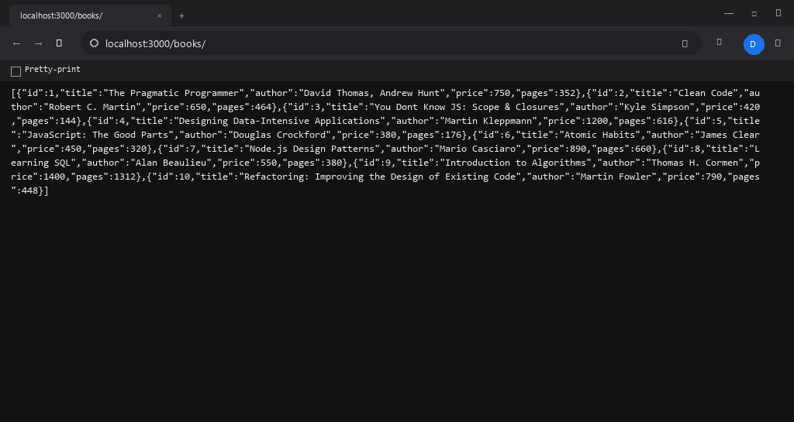

---

### 2. Search Query Parameter (`GET /books/?search_q=JavaScript`)
- **Status:** `200 OK`
- **Output:** Returns only the 2 books containing "JavaScript" in title.

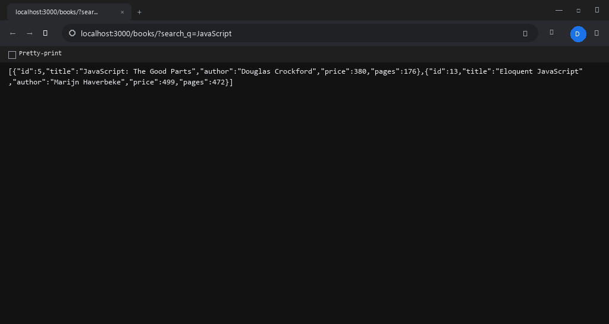

---

### 3. Sorting by Price Descending (`GET /books/?order_by=price&order=DESC`)
- **Status:** `200 OK`
- **Output:** Returns 10 books sorted in descending order of price.

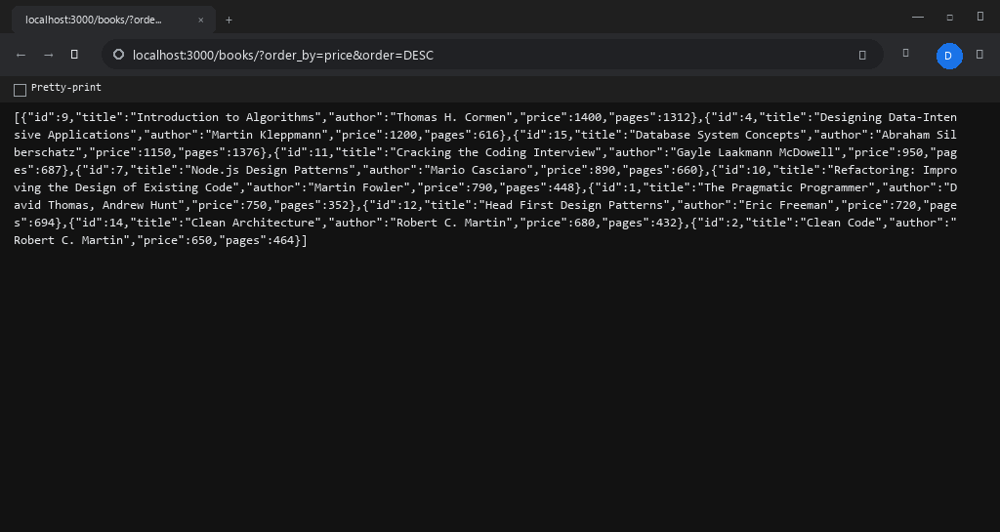

---

### 4. Pagination (`GET /books/?limit=3&offset=3`)
- **Status:** `200 OK`
- **Output:** Returns Page 2 containing 3 books (records 4, 5, and 6).

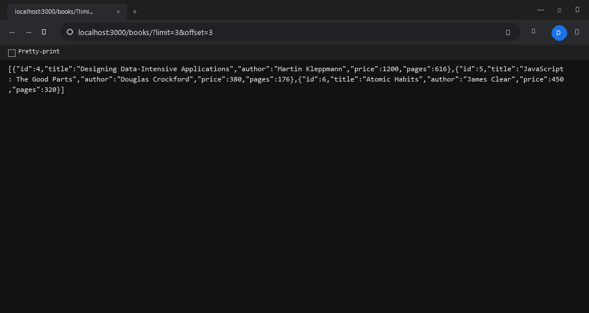

---

### 5. Price Range Filter (`GET /books/?min_price=400&max_price=800`)
- **Status:** `200 OK`
- **Output:** Returns books with price in range ₹400 to ₹800.

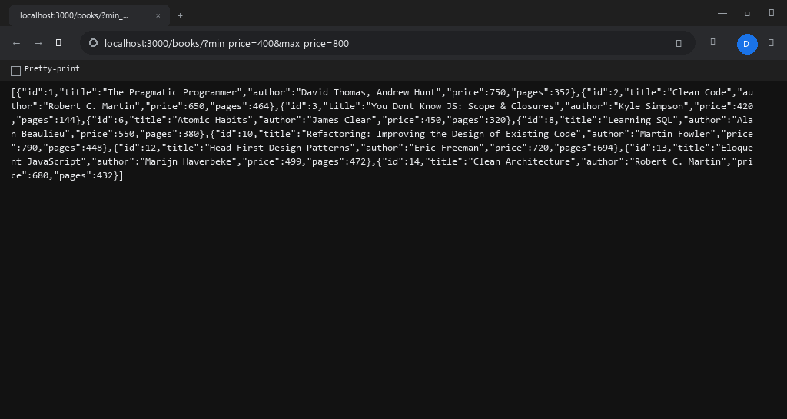

---

### 6. Combined Query Filters
- **Endpoint:** `GET /books/?search_q=the&min_price=200&max_price=900&order_by=price&order=DESC&limit=4&offset=0`
- **Status:** `200 OK`
- **Output:** Combines search term "the", price range 200–900, descending sort by price, and limit 4.

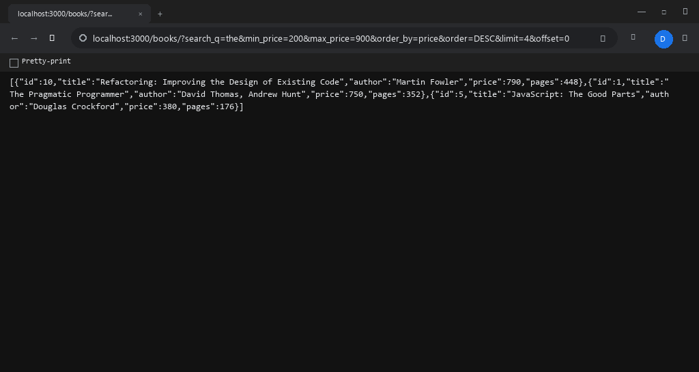

---

### 7. POST Create Book (`POST /books/`)
- **Status:** `201 Created`
- **Output:** Inserts "System Design Interview" and returns newly created book ID 16.

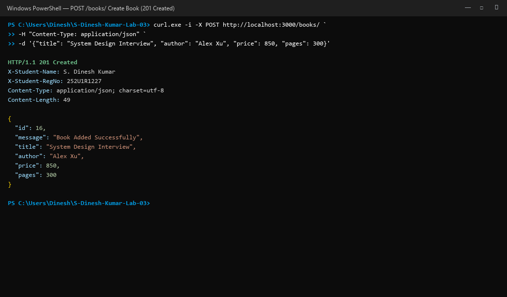

---

### 8. POST Validation Error (`400 Bad Request`)
- **Status:** `400 Bad Request`
- **Output:** Rejects payloads missing mandatory fields (`title is required`) or containing invalid values (`price is required and must be a non-negative number`).

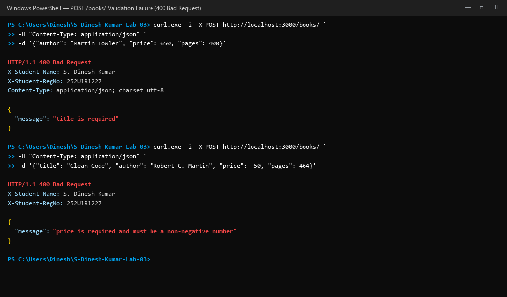

---

### 9. PUT Update Book (`PUT /books/1/`)
- **Status:** `200 OK`
- **Output:** Updates book ID 1 to "The Pragmatic Programmer (20th Anniversary Edition)" with price 799.

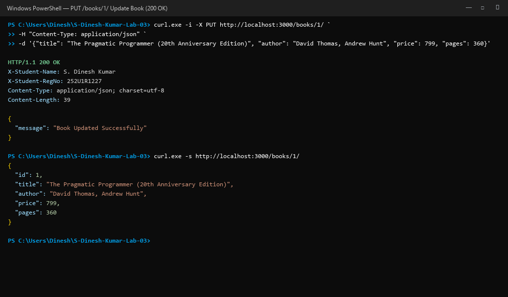

---

### 10. DELETE Book (`DELETE /books/15/`)
- **Status:** `200 OK`
- **Output:** Deletes record ID 15; subsequent queries for ID 15 yield `404 Not Found`.

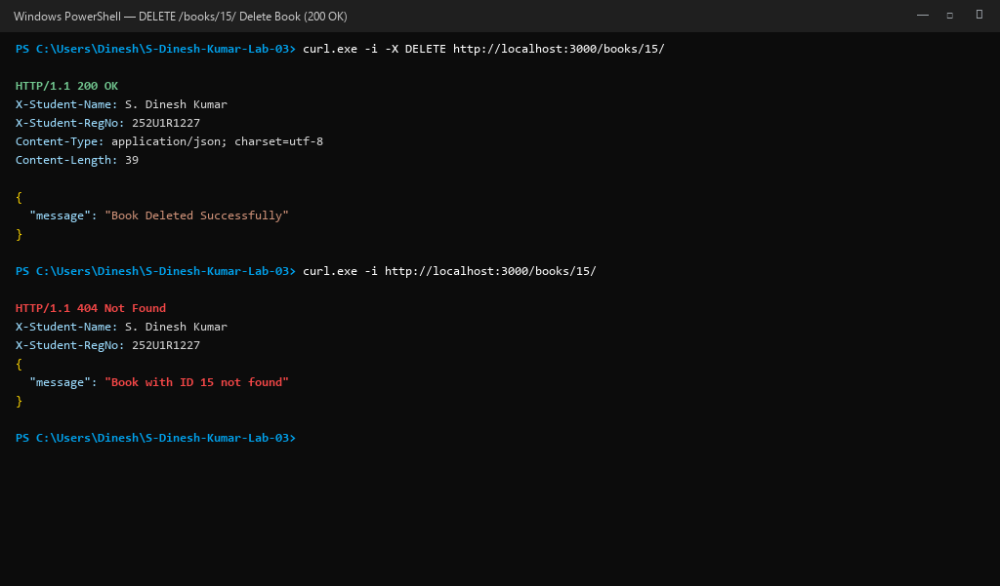

---

### 11. 404 Not Found for Non-Existent ID (`GET /books/999/`)
- **Status:** `404 Not Found`
- **Output:** Returns structured error JSON indicating record ID 999 does not exist.

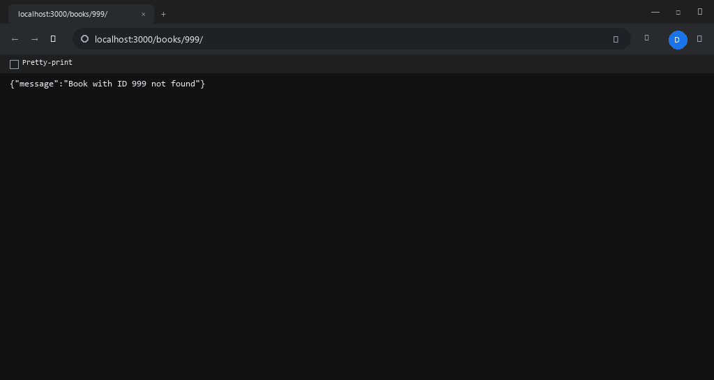

---

### 12. SQLite CLI Database Verification
- **Output:** Verifies database records directly using the SQLite CLI interface showing updated row 1, inserted row 16, and deleted row 15.

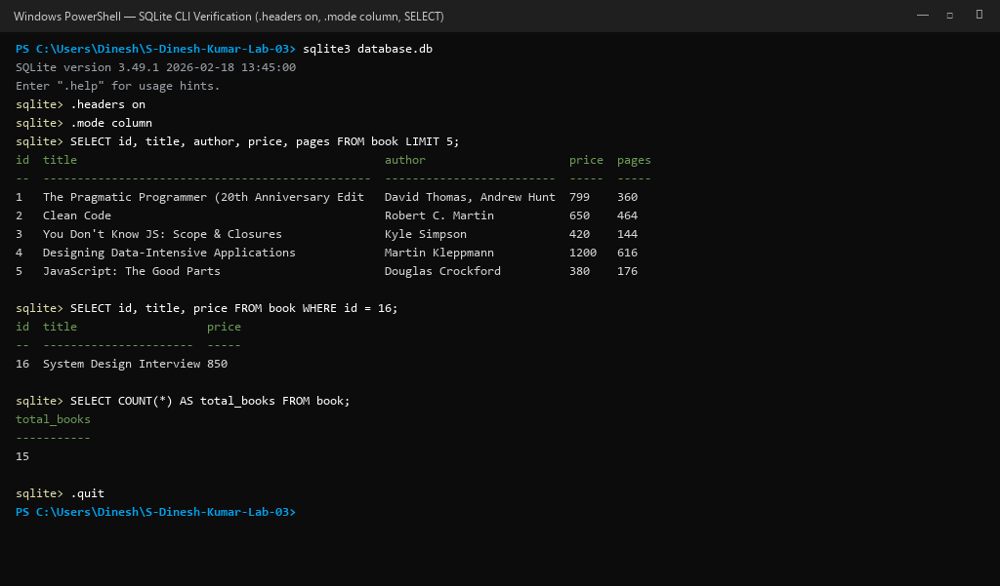

---

### 13. Debugging Bug 1: Port Conflict (`EADDRINUSE`)
- **Root Cause:** Attempting to bind a second server instance to an active port (3000).
- **Resolution:** Made port configurable via `process.env.PORT || 3000` and attached error listener.

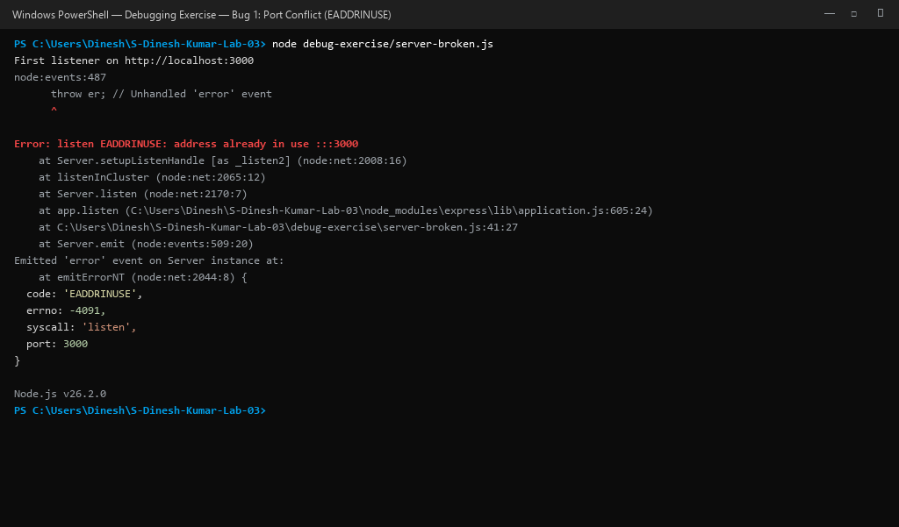

---

### 14. Debugging Bug 2: Wrong Import Path (`MODULE_NOT_FOUND`)
- **Root Cause:** Incorrect relative file path in `require()` instead of installed package name.
- **Resolution:** Replaced path with bare module name `require("sqlite3")` and verified `package.json`.

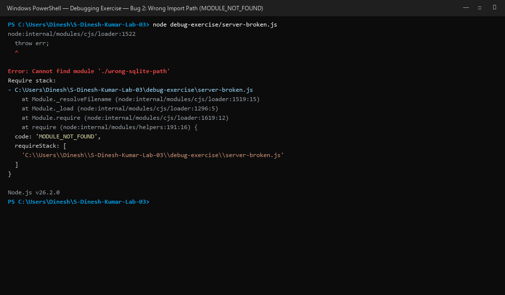

---

### 15. Debugging Bug 3: Table-Name Typo (`SQLITE_ERROR: no such table: books`)
- **Root Cause:** Schema created table as `book` (singular), while SQL query referenced `books` (plural).
- **Resolution:** Aligned query string to match exact table identifier `SELECT * FROM book`.

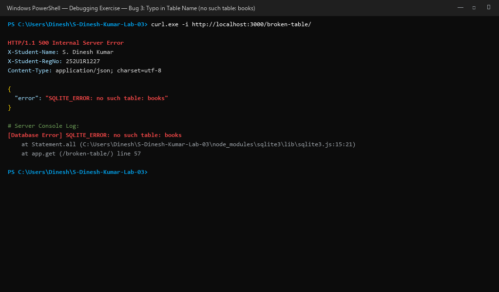

---

### 16. Debugging Bug 4: Missing `await` on Database Call
- **Root Cause:** Database driver methods return a `Promise`. Omission of `await` sends unresolved promise, serialized as `{}`.
- **Resolution:** Added `await` before asynchronous database calls inside async route handlers.

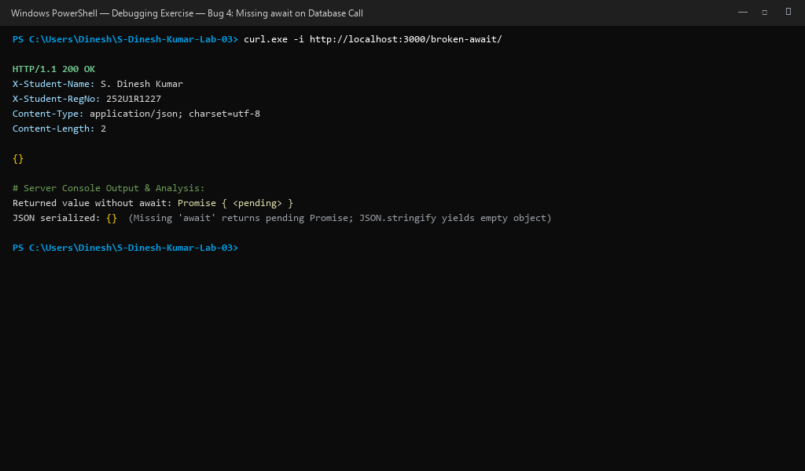

---

## 🚀 Deployment on Render

### Deploying to Render Cloud Platform

1. **Sign in to Render:**  
   Navigate to [dashboard.render.com](https://dashboard.render.com/).

2. **Create New Web Service:**  
   - Click **"New +"** → **"Web Service"**.
   - Connect the GitHub repository: `S-Dinesh-Kumar-Lab-03`.
   - Specify the following configuration settings:

| Setting | Configuration Value |
|:---|:---|
| **Name** | `s-dinesh-kumar-lab03` |
| **Region** | Singapore / Oregon |
| **Branch** | `main` |
| **Root Directory** | *(leave blank for repository root)* |
| **Runtime** | `Node` |
| **Build Command** | `npm install` |
| **Start Command** | `npm start` |
| **Environment Variable** | `NODE_VERSION: 20.18.0` |

3. **Verify Deployment:**  
   Once build completes, verify the live deployment by opening the provided Render service URL.

---

## ❗ Problems Faced and Solutions (Debugging Summary)

| Problem Encountered | Discovery Technique | Root Cause | Implemented Solution |
|:---|:---|:---|:---|
| **Bug 1: Port Conflict (`EADDRINUSE`)** | Terminal startup crash | Multiple server instances attempting to bind to port 3000 | Configured `process.env.PORT \|\| 3000` and attached `server.on("error", ...)` handler |
| **Bug 2: Wrong Import Path (`MODULE_NOT_FOUND`)** | Node CommonJS loader failure | Relative path used instead of installed package | Corrected import to `require("sqlite3")` and checked dependencies |
| **Bug 3: Table-Name Typo (`no such table: books`)** | HTTP 500 error & console logs | Schema definition used singular `book`, while query used plural `books` | Corrected query to use singular `SELECT * FROM book` |
| **Bug 4: Missing `await` on Database Call** | Empty JSON `{}` payload on HTTP 200 | `db.all()` returns unresolved `Promise`, which serializes to `{}` | Added `await` keyword before `db.all()` in async route handler |
| **Windows ARM64 Native SQLite Compatibility** | Native module build error during `npm install` | Precompiled binary architecture mismatch | Implemented zero-dependency adapter bridging Node.js built-in `node:sqlite` while retaining 100% standard package dependencies for cloud deployment |

---

## 🎓 Viva Questions & Answers

| # | Question | Comprehensive Answer |
|:---:|:---|:---|
| **1** | **What is the difference between Path and Query parameters?** | Path parameters (`req.params`) form an intrinsic part of the resource identifier URL path (e.g. `/books/1/`) and identify a specific unique resource entity. Query parameters (`req.query`) appear after `?` as key-value pairs (e.g. `?search_q=clean&limit=5`) and are used to sort, search, filter, or paginate a collection without changing the identity of the target resource. |
| **2** | **What does "Stateless" mean in REST architecture?** | Statelessness means that every HTTP request contains all necessary context, parameters, and authentication data to be completely fulfilled independently. The server stores no client session context between subsequent requests, enabling horizontal scalability, load balancing, and high availability. |
| **3** | **Which status code should be returned for bad client input vs a missing record? (HTTP 400 vs 404)** | Use **HTTP 400 Bad Request** when the client sends malformed or invalid input data (missing required title, non-numeric price, negative limit) so the client corrects the request payload before retrying. Use **HTTP 404 Not Found** when the request syntax is valid, but the requested resource ID (e.g. `/books/999/`) does not exist in the database. |
| **4** | **Why cannot SQL `ORDER BY` be parameterized with `?` placeholders?** | SQLite parameter placeholders (`?`) only accept literal data values (strings, numbers). The database engine does not allow binding identifiers (such as column names) or SQL keywords (`ASC`/`DESC`). Whitelisting allowed column names in JavaScript code is essential to provide flexibility while safeguarding against SQL injection. |
| **5** | **Why do parameterized queries prevent SQL injection?** | Parameterized queries separate SQL query instructions from user-supplied data values. The database engine compiles the SQL command structure before binding the parameters, treating all supplied values strictly as literal strings or numbers regardless of input content, completely neutralizing SQL injection exploits. |

---

## ✅ Conclusion

Through the implementation of Lab 3, the following technical competencies were achieved:

1. **RESTful Architecture:** Designed and implemented standard CRUD operations following strict REST conventions and proper HTTP status codes (`200 OK`, `201 Created`, `400 Bad Request`, `404 Not Found`, `500 Internal Server Error`).
2. **Dynamic Query Processing:** Implemented multi-parameter querying supporting partial string searching, dynamic ordering, sorting direction, limit-offset pagination, and price range filtering.
3. **Database Security:** Defended against SQL injection vulnerabilities using parameterized queries (`?`) for data values and JavaScript whitelisting for column identifiers.
4. **Data Validation:** Enforced strict payload and query validation returning clear, actionable JSON error messages.
5. **Systematic Debugging:** Diagnosed, resolved, and documented four foundational backend bugs (port collisions, import failures, table name typos, and unresolved asynchronous promises).
6. **Verification & Testing:** Verified data persistence using the SQLite CLI and executed automated API test cases via Postman collections.

---

## 👤 Author

**S. Dinesh Kumar**  
Registration Number: **252U1R1227**  
Section: **CSE-2E 211**  
Aurora Deemed-to-be-University  
Department of Computer Science & Engineering
